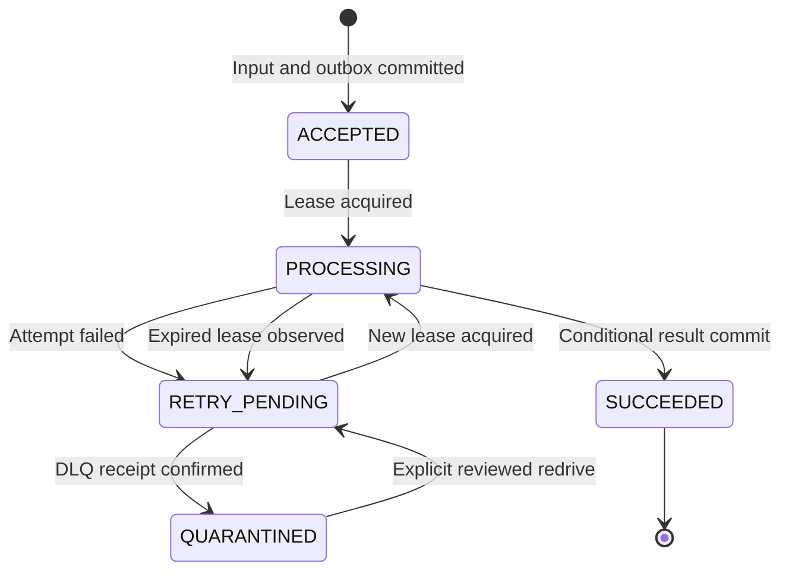

# Job lifecycle and idempotency contract

Status: proposed implementation contract. These guarantees are not implemented or proven by the existing health-demo tests.

## Durable acceptance

1. Derive a stable job ID from the submission idempotency key and record the content hash.
2. Store the immutable input object.
3. Atomically create the job and pending-dispatch outbox entries.
4. Return HTTP 202 with the job ID.
5. Reconcile pending outbox entries into SQS. Mark dispatch complete only after successful publication.

A retry with the same idempotency key and content returns the existing job. The same key with different content is a conflict. Two concurrent submissions must converge on one record through conditional creation, not read-then-write.

Crash after upload but before the transaction: input may be orphaned; no job was acknowledged. Crash after the transaction but before the response: retry discovers the accepted job. Crash after queue send but before marking dispatch: a repeated send is expected and safe.

For the initial single-customer lab, key scope is that synthetic customer. Production tenant authorization and key scoping need their own design before real data is accepted.

## State model

QUEUED is dispatch metadata rather than a job state. A delayed dispatcher update must not overwrite PROCESSING or SUCCEEDED.

Visibility and lease expiry do not automatically update the database. A delivery handler or reconciler must perform the checked transition. A DLQ observer marks QUARANTINED only after observing the message there and conditionally confirming that the job is nonterminal and has no current processing owner. A duplicate in the DLQ must never change SUCCEEDED to QUARANTINED; a processing error alone is not proof of DLQ delivery.

Expose submission, dispatch, attempt, and failure details through the status API. An unprocessed accepted job must remain discoverable even while the queue is unavailable.

## Claim, heartbeat, commit

Each attempt has a unique token, increasing fencing generation, owner identity, lease expiry, and absolute attempt deadline.

Acquire ownership atomically if the job is eligible and has no unexpired lease. Use conditional updates/transactions in DynamoDB; the local adapter must test equivalent conflict behavior. Do not rely on process-local locks as the distributed guarantee.

Heartbeat updates require the current token/generation. Renew the processing lease and message visibility while the attempt is within its deadline. Renewal of those two systems is not atomic: a lost renewal must stop the attempt from committing unless it can still prove current ownership. A heartbeat must never extend an attempt indefinitely.

Write output to an immutable, attempt-specific object key. Commit the canonical output pointer and SUCCEEDED state using one conditional database update that requires:
- Current attempt token and generation.
- Unexpired lease.
- A nonterminal eligible job state.

An older worker may still consume CPU or leave an orphan attempt output after losing ownership. It must not overwrite the canonical result. Delete the SQS message after the result commit. A later duplicate can read SUCCEEDED and acknowledge without creating another canonical result.

This provides at-most-one canonical committed result for our workload. It is not a claim of exactly-once execution, exactly-once external side effects, or atomic S3-plus-DynamoDB transactions.

## Failure handling

| Condition | Required behavior |
| --- | --- |
| Transient dependency error | Log categorized failure; release ownership with a checked transition; allow bounded redelivery |
| Known malformed/unsupported document | Record failure reason; let bounded delivery/quarantine policy isolate it; valid work continues |
| Another unexpired owner | Do not process or acknowledge its in-progress job; defer the delivery |
| Job already succeeded | Acknowledge duplicate; return existing result |
| Old worker resumes | Reject stale heartbeat/commit |
| Worker dies after commit, before message delete | Next delivery acknowledges existing result |
| Worker dies after output write, before commit | New attempt may produce a new object; only its valid commit establishes the canonical result |
| DLQ contains a job | Mark quarantine after observation, retain input and failure evidence; require reviewed redrive |
| State store unavailable | Fail closed for claiming/committing; keep the message undeleted |

Do not apply TTL deletion or input-object lifecycle expiry to unresolved accepted jobs. Retain inputs, canonical outputs, and records through processing and the agreed quarantine-review window; clean up orphan attempt outputs separately. Retention enforcement must preserve the acceptance boundary. Teardown explicitly destroys the synthetic lab and is a separate operator action.

No automatic DLQ redrive or custom task restart in the first release.

## Tests required before cloud deployment

- Concurrent submission with the same key and content; conflicting reuse of a key.
- Object write succeeds but database transaction fails.
- Job/outbox commit succeeds but queue publication fails.
- Publication succeeds but dispatch marking fails.
- Simultaneous duplicate deliveries and lease contention.
- Lease expiry followed by takeover; stale owner tries to commit.
- Database commit succeeds but message deletion fails.
- Poison and valid messages interleaved.
- Dependency outage with restoration and with retry exhaustion.
- Reconciler accounts for pending dispatch, expired processing, and observed DLQ jobs.

Unit/fake-adapter tests establish application behavior only. Local emulation does not prove real AWS IAM, timing, delivery, scaling, or failure semantics. Repeat the relevant cases in an approved AWS environment and retain the evidence.
